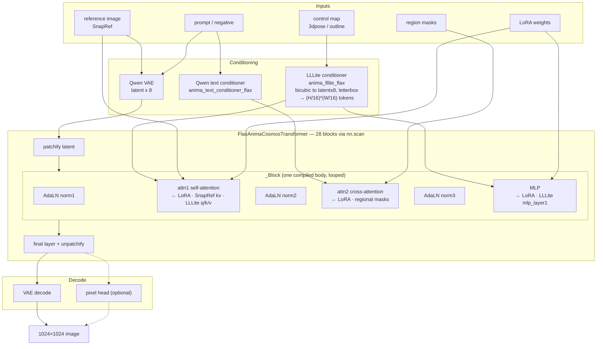

# Architecture and status — Anima Flax port

> **Scope.** This is the *model and feature* map: what the transformer is, how the four
> conditioning features hook into it, which runtime supports which mode, and what is proven.
> For *serving* architecture — the persistent TPU server, Gradio UI, cloudflared tunnel and
> the file-based IPC protocol — see
> `anima_tpu_project/reports/ARCHITECTURE.md`. For TPU operational status see
> `anima_tpu_project/reports/CONSOLIDATED_STATUS.md`. A rendered diagram of this document
> lives at `docs/model-diagram.html`.

Anima (a flow-matching DiT image model) ported to JAX/Flax, with four conditioning
features layered on top: **LoRA**, **SnapRef** (character reference), **LLLite**
(ControlNet-LLLite: 3D pose / outline / regional control) and **regional** prompting.

This document is the map. It records what exists, which runtime supports what, and what is
actually proven versus assumed. Numbers here were measured on this machine or on TPU and
are labelled with the check that produced them; nothing is copied from a README.

Upstream: fork of `averous12/maxdiffusion-anima` (see `FORK_SUMMARY.md` for divergence).

---

## 1. Repository map

```
maxdiffusion/
├── src/maxdiffusion/
│   ├── models/
│   │   ├── anima_cosmos_flax.py        697 L  transformer: _Attention / _Block / _ScannedBlock
│   │   ├── anima_lora_flax.py          695 L  LoRA load, merge, apply
│   │   ├── anima_lllite_flax.py        588 L  ControlNet-LLLite (28 blocks × attn q/k/v + mlp)
│   │   ├── anima_snapref_flax.py       462 L  SnapRef reference adapter
│   │   ├── anima_regional.py           267 L  region schedules and masks
│   │   ├── anima_pixel_head_flax.py    246 L  optional pixel-space decoder
│   │   └── anima_text_conditioner_flax.py 101 L  Qwen text conditioner
│   ├── schedulers/scheduling_flow_match_flax.py   flow-match sigma schedule
│   └── utils/                                      shared helpers
├── scripts/
│   ├── anima_aesthetic_server.py      1994 L  the real runtime: all six control modes
│   ├── anima_gradio_ui.py             1920 L  browser UI over the server
│   ├── anima_aesthetic_tpu.py          312 L  TPU smoke/validation driver
│   ├── anima_regional_ui.py                   regional mask editor UI
│   ├── anima_colab_setup.py                   Colab venv bootstrap
│   ├── anima_cloudflared.py                   tunnel helper
│   └── anima_scan_e2e.py                      scan equivalence harness
└── ops/                                       34 probe/test scripts (see §6)
```

## 2. Two runtimes, deliberately different scope

This is the single most important structural fact, and the most common source of surprise.

| Runtime | File | Supports |
|---|---|---|
| **Server** (production) | `scripts/anima_aesthetic_server.py` | all six modes: plain, regional, snapref, lllite, regional+snapref, lllite+snapref |
| **TPU driver** (validation) | `scripts/anima_aesthetic_tpu.py` | plain, lllite only |

Measured by counting feature references in each file:

```
snapref    tpu 0    server 147
regional   tpu 0    server  53
lllite     tpu 23   server  67
```

So the TPU driver cannot exercise SnapRef or regional at all. Any claim about those two is
server-only. LLLite is the one feature that exists in both, because it was needed on TPU.

**LLLite is a feature of the driver, not a fork of it.** It is env-gated: with `LLLITE_CKPT`
unset the driver imports nothing extra, loads nothing, and the plain `tf_step` body is
character-identical to the pre-LLLite version. The conditioning embedding is a closure
constant because it does not vary with `t`, which leaves every denoise call site untouched.

## 3. Control-mode matrix

| Mode | Server | TPU driver | Notes |
|---|---|---|---|
| plain | yes | yes | baseline |
| regional | yes | **no** | server only |
| snapref | yes | **no** | server only |
| lllite | yes | yes | |
| regional + snapref | yes | **no** | |
| lllite + snapref | yes | **no** | separate jit on the server |
| regional + lllite | **refused** | n/a | rejected by design |

`regional + lllite` is refused in the server with
`SUPPORTED_CONTROL_COMBOS` as the error payload:

```python
SUPPORTED_CONTROL_COMBOS = ("plain", "regional", "snapref", "lllite",
                            "regional+snapref", "lllite+snapref")
```

Reason: regional prediction replaces the base prediction per region, so a whole-image LLLite
control would be silently dropped — the image would look controlled while ignoring the
control map. Refusing is honest; silently ignoring is not.

## 4. System diagram



### Where each feature hooks the transformer

| Feature | Hook point | Mechanism |
|---|---|---|
| **LoRA** | q/k/v/out projections, `ff_in`/`ff_out` | additive low-rank delta on the dense kernel |
| **SnapRef** | `attn1` | cached reference keys/values prepended; per-key bias on the score matrix |
| **LLLite** | **inputs** to q/k/v projections, and the MLP input | per-block FiLM-modulated residual, added pre-projection |
| **regional** | `attn2` | per-region attention masks during the scheduled window |

LLLite editing the q/k/v **inputs** (not the projections' output) matches the reference
implementation: `comfy/ldm/cosmos/predict2.py` runs the attention patch over
`q_input/k_input/v_input` before calling `q_proj/k_proj/v_proj`, which is what
`target_atomics = self_attn_q_pre, self_attn_kv_pre` means — the tensors are *named* `*_proj`
but are consumed as pre-projection. The port reproduces that ordering; it was confirmed
against a PyTorch transcription of `comfy/ldm/anima/lllite.py`, not inferred from shapes.

## 5. Validation status

Proven — reproduced by a command in this repo:

| Claim | Number | Check |
|---|---|---|
| LLLite matches the ComfyUI reference | conditioning max abs diff **2.742e-06**, rel **9.379e-07**; 828 tensors, `missing=0 unexpected=0` | `ops/lllite_parity.py` |
| ...on all three checkpoints | 6200 / outline_7000 / regional_4335 → 2.742e-06 / 4.411e-06 / 5.305e-06 | `ops/lllite_parity.py` |
| LLLite rides `nn.scan`, scan ≡ loop | max abs diff **1.144e-05** (fp32 fusion order) | `ops/lllite_scan_test.py` |
| strength 0 is inert | **0.000e+00** vs no LLLite, bit-exact | `ops/lllite_scan_test.py`, `ops/lllite_full_forward.py` |
| full transformer forward, 28 layers | delta linear in strength: **3.41e-02 / 6.82e-02 / 1.36e-01** at 0.5 / 1.0 / 2.0 | `ops/lllite_full_forward.py` |
| token grid law | `(H/16)*(W/16)`; 1024² → **4096** | driver log, `match=True` |
| LLLite cost on TPU | **2303–2341 ms/step** vs **1896 ms/step** baseline (+21–24%) | TPU run, 20 steps |
| control changes the image | strength 1.0 vs 0.0 differ on **643,837 px** (mean 39.7, max 255) | TPU sweep, sha256 + pixel diff |
| letterbox preserves proportions | figure bbox aspect **1.724** vs true **1.720**; stretch gave **1.149** | `preprocess_control(aspect=...)` |

Not proven — do not claim these:

* **Pose adherence is unproven.** The control demonstrably changes the image, but the
  generation has not yet been shown to reproduce the control's pose. The last judged run
  used strength 1.0 with a prompt that already implied the composition, so the result was
  consistent with the control being ignored.
* **Only the 3dpose checkpoint has run end to end.** outline_7000 and regional_4335 are
  parity-tested only.
* **`lllite + snapref` in one pass is untested.** The two hooks touch different tensors and
  the jit exists, but no combined run has been made.
* **SnapRef and regional have never run on TPU** through the driver (§2).

## 6. ops/ — probes, not library code

34 scripts. They are diagnostics kept for reproducibility, not an API surface:

* `lllite_parity.py`, `lllite_scan_test.py`, `lllite_full_forward.py`, `lllite_block_hook.py` — the four checks in §5
* `snapref_*` (20 files) — SnapRef probes and browser-driving scripts, including older
  `snapref_scan_probe{,2,3,4}.py` iterations that are superseded
* `test_*.py` (6) — API-contract, UI-contract and watchdog tests
* `run_lllite_sweep.py` — drives the repo driver at several strengths (default 0.0/2.0/4.0)
* `anima_tpu_bootstrap.py` — Colab VM bootstrap: clone, overlay, setup, then the sweep

## 7. Known issues

| Issue | Impact | Where |
|---|---|---|
| `adapter_block_map` assumes an iterable | `TypeError: 'int' object is not iterable` if called with a scalar layer count | `anima_snapref_flax.py:65` |
| TPU driver lacks SnapRef + regional | modes untestable off-server | `anima_aesthetic_tpu.py` |
| Pose adherence unverified | LLLite effect proven, correctness not | §5 |
| Superseded `snapref_scan_probe{2,3,4}.py` | clutter in `ops/` | `ops/` |

## 8. Running it

```bash
# CPU: the four LLLite checks (no GPU/TPU needed)
PYTHONPATH=src python ops/lllite_parity.py
PYTHONPATH=src python ops/lllite_scan_test.py
PYTHONPATH=src python ops/lllite_full_forward.py
LL_LAYERS=28 PYTHONPATH=src python ops/lllite_full_forward.py

# TPU: bootstrap then sweep strengths 0.0 / 2.0 / 4.0
python ops/anima_tpu_bootstrap.py
```

The driver takes its configuration from the environment, so no forked copy is needed:

| Variable | Meaning |
|---|---|
| `LLLITE_CKPT` | LLLite checkpoint; **unset leaves the run as the plain baseline** |
| `LLLITE_CONTROL` | control map (3D pose / outline) |
| `LLLITE_STRENGTH` | control strength |
| `LLLITE_ASPECT` | `letterbox` (default) or `stretch` |
| `ANIMA_PROMPT` / `ANIMA_STEPS` / `ANIMA_OUT` | prompt, step count, output name |
